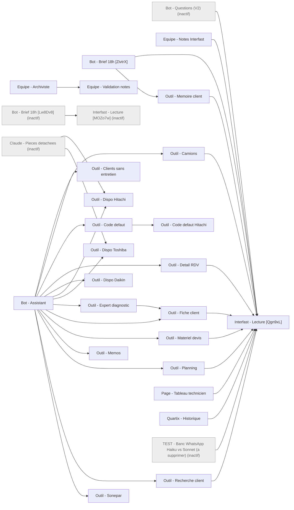

# Index des workflows n8n ClimatPro

60 workflows exportés. Fiche détaillée : `docs/<nom>.md`, JSON : `workflows/<nom>.json`.

| Workflow | Actif | Déclencheur | Rôle |
|---|---|---|---|
| [Archives factures - Correspondance Interfast](archives-factures-correspondance-interfast.md) | non | manuel (Manual Trigger 'Lancer') | Rapproche les clients des anciennes factures (Sheet Index-Factures-ClimatPro) avec les fiches clients Interfast et écrit les nouveaux gro… |
| [Archives factures - Extraction index](archives-factures-extraction-index.md) | non | cron toutes les 30 min (Schedule Trigger, Europe/Paris) | Lit par lots les PDF de factures d'avant Interfast dans Drive, les fait extraire par Claude Haiku et remplit le Google Sheet Index-Factur… |
| [Archives factures - Liste à traiter](archives-factures-liste-a-traiter.md) | non | cron 0 3 1 1 * (1er janvier 3h, de fait manuel) | Liste les factures d'archives restant à indexer (dédoublonnées, hors Interfast, hors déjà indexées) et l'écrit dans l'onglet A_traiter du… |
| [Archives factures - Notes Interfast + Pilotage](archives-factures-notes-interfast-pilotage.md) | non | manuel (3 Manual Triggers : Lancer / Reformater les notes / Calculer pilotage) | Écrit (POST) puis reformate (PUT) dans Interfast la note « Historique ClimatPro avant Interfast » des clients validés dans Correspondance… |
| [Assistant ClimatPro — Identification Laurent](assistant-climatpro-identification-laurent.md) | non | telegram (Telegram Trigger, message) | Squelette vide (un seul Telegram Trigger, aucune connexion) ayant servi à identifier le chat_id Telegram de Laurent. |
| [Bot - Assistant](bot-assistant.md) | oui | telegram (Telegram Trigger, message, privé uniquement) | Assistant Telegram libre (AI Agent Claude Haiku + 14 outils sous-workflows) pour Laurent et les techniciens : planning, clients, matériel… |
| [Bot - Bilan hebdo](bot-bilan-hebdo.md) | oui | cron 0 20 8 * * 1 (lundi 8h20) | Chaque lundi, résume l'usage du bot sur 7 jours (questions par personne, hors sujet/sensibles, quotas) depuis le journal Google Sheet et… |
| [Bot - Brief 18h](bot-brief-18h--Lw8Dv81qmxIMwXVI.md) | non | cron quotidien 18h00 (Schedule Trigger days) + manuel | V1 obsolète du brief du soir : interventions Interfast de J+1 enrichies (intervention, client, devis, matériel) envoyées en Telegram à un… |
| [Bot - Brief 18h](bot-brief-18h--ZivtrXedkHo5phMD.md) | oui | cron 0 0 18 * * 0-5 (18h dim-ven) + cron 0 15 8 * * 1-5 (8h15 lun-ven), Europe/Paris | Brief Telegram du soir (interventions du lendemain par technicien, alerte camions et mémo clients aux admins) et récap du matin aux admin… |
| [Bot - Questions (V2)](bot-questions-v2.md) | non | telegram (Telegram Trigger, message) | Bot Telegram minimal (prochain RDV, téléphone, adresse) : Haiku classe l'intention, le code lit Interfast via Interfast - Lecture et répo… |
| [Claude - Pieces detachees](claude-pieces-detachees.md) | non | webhook POST /webhook/pieces-detachees (cle x-cle verifiee dans le code) | Passerelle pour Claude vers les outils de dispo pieces Toshiba/Hitachi (role admin), lecture seule. |
| [Claude - SCAN vers MAIL pour PJ](claude-scan-vers-mail-pour-pj.md) | non | webhook POST /webhook/claude-envoi-fichier (sans authentification) | Telecharge un fichier Drive et l'envoie par Gmail (mode send) ou cree un brouillon Gmail avec PJ. |
| [Climapro - Cache clients GPS](climapro-cache-clients-gps.md) | oui | cron 3h07 quotidien (Europe/Paris) | Chaque nuit, lit les fiches clients Interfast, geocode via IGN les nouvelles/modifiees et met a jour la table clients_gps. |
| [Climapro - Clients sans entretien](climapro-clients-sans-entretien.md) | oui | cron 3h22 quotidien (Europe/Paris) | Chaque nuit, relit toutes les interventions Interfast et liste dans la table clients_sans_entretien les clients avec une pose depuis 6 mo… |
| [Climapro - Devis acceptes par mail](climapro-devis-acceptes-par-mail.md) | oui | cron toutes les 15 min + webhook GET /webhook/devis-mail-valider (jeton usage unique) | Detecte dans les mails recus (3 jours) les acceptations de devis via Haiku, verifie le devis dans Interfast, alimente la table devis_a_pl… |
| [Climapro - Devis signes a planifier](climapro-devis-signes-a-planifier.md) | oui | cron toutes les 30 min (Europe/Paris) | Liste les devis signes Interfast (toPlan) sans intervention associee dans la table devis_a_planifier lue par le tableau de bord, avec res… |
| [Climapro - Images tableau de bord](climapro-images-tableau-de-bord.md) | oui | cron toutes les 15 min + declencheur manuel | Synchronise les images Drive (Tableau de bord ClimatPro > images, icones) vers la mediatheque WordPress climatpro.fr, note l'URL dans la… |
| [Climapro - Mémos vocaux](climapro-memos-vocaux.md) | oui | webhook POST /webhook/climapro (headerAuth X-Key) | Classe un memo vocal iPhone avec Haiku et le range en tache Todoist (bon projet/section/labels) ou en note sur la fiche client Interfast,… |
| [Climapro - Ranger mémo (pro ou perso)](climapro-ranger-memo-pro-ou-perso.md) | oui | webhook POST /webhook/climapro-ranger (headerAuth X-Key) | Range le dernier memo Todoist marque pro-ou-perso dans Perso, Equipe ClimatPro (ou Commandes materiel) ou Laurent ClimatPro selon la repo… |
| [Equipe - Archiviste](equipe-archiviste.md) | oui | telegram (bot @Team_ClimatPro_bot, updates message + callback_query) | Bot muet du groupe Telegram ClimatPro Equipe : archive chaque message dans la table equipe_messages, range les photos dans Drive (fil-equ… |
| [Equipe - Fil (tableau)](equipe-fil-tableau.md) | oui | webhooks GET /webhook/equipe-fil, POST /webhook/equipe-envoyer, GET /webhook/equipe-photo | Backend du Fil equipe du tableau de bord : lecture des 40 derniers messages, publication texte/photo dans le groupe Telegram au nom du me… |
| [Equipe - Mail vers groupe Telegram](equipe-mail-vers-groupe-telegram.md) | non | cron toutes les 5 min | Relaie les mails Gmail etiquetes Telegram (Label_37) dans le groupe Telegram equipe (texte + pieces jointes), trace une ligne dans le fil… |
| [Equipe - Notes Interfast](equipe-notes-interfast.md) | oui | cron toutes les 5 min | Haiku analyse le lot de messages non traites du fil equipe (avec le planning Interfast du jour) : notes client envoyees a Laurent pour va… |
| [Equipe - Rappel notes a valider](equipe-rappel-notes-a-valider.md) | oui | cron 0 18 * * * (18h quotidien) | Chaque soir, envoie a Laurent en prive sur Telegram la liste des notes du fil equipe encore au statut a_valider. |
| [Equipe - Validation notes](equipe-validation-notes.md) | oui | sous-workflow (entree update = objet update Telegram) | Traite la decision de Laurent sur une note a valider (bouton nv:<id>:ok/no ou reponse nom/id client), ecrit la note sur la fiche client I… |
| [Import - Codes defaut Toshiba](import-codes-defaut-toshiba.md) | oui | cron mensuel, le 1er a 06:07 | Scrape la page publique des codes defaut Toshiba France et met a jour par upsert la Data Table codes_defaut (marque Toshiba), sans touche… |
| [Import - Codes Hitachi (temporaire)](import-codes-hitachi-temporaire.md) | non | webhook POST /webhook/import-hitachi-5e7ba5a315866c5e (origine hitachiaircon.com, jeton dans le body) | Reception temporaire de lignes de codes d'alarme Hitachi en JSON et insertion bulk dans une Data Table. |
| [Interfast - Lecture](interfast-lecture--MOZo7wkYxjOghKVZ.md) | non | sous-workflow (entrees path, query) | Premiere version du sous-workflow de lecture seule Interfast : chemin GET verifie contre une liste blanche, appel authentifie, suppressio… |
| [Interfast - Lecture](interfast-lecture--Qgn9xL6dGSAcq4Zv.md) | oui | sous-workflow (entrees op, params) | Point d'acces unique en lecture seule a Interfast : traduit une operation nommee (events_jour, intervention, client, client_recherche, de… |
| [Interfast — Test connexion GET](interfast-test-connexion-get.md) | non | manuel | Test manuel du credential Interfast : un GET /v1/events?page=1&count=1. |
| [Outil - Camions](outil-camions.md) | oui | sous-workflow (Appel outil : date_debut, jours) | Outil du bot : disponibilite des 2 camions (Christophe, Axel) par demi-journee a partir des interventions et RDV Interfast, calcul en code. |
| [Outil - Clients sans entretien](outil-clients-sans-entretien.md) | oui | sous-workflow (Appel outil : villes, mois_min, client_id, rayon_km) | Outil du bot : liste les clients avec clim posee par ClimatPro sans entretien depuis X mois (table pre-calculee), filtrable par ville ou… |
| [Outil - Code defaut](outil-code-defaut.md) | oui | sous-workflow (Appel outil : marque, code, modele, demandeur) | Outil du bot : signification d'un code defaut Toshiba/Daikin (table codes_defaut) ou Hitachi (sous-outil), alerte Telegram des admins si… |
| [Outil - Code defaut Hitachi](outil-code-defaut-hitachi.md) | oui | sous-workflow (Appel : code, modele, demandeur) + Test manuel | Sous-outil Hitachi : libelle du code alarme par modele (table codes_hitachi), fiche PDF officielle hitachi-mp.spelog.com resumee par Sonn… |
| [Outil - Detail RDV](outil-detail-rdv.md) | oui | sous-workflow (Appel outil : event_id) | Outil du bot : detail complet d'une intervention Interfast (description, consignes, acces, techniciens, compte-rendu). |
| [Outil - Dispo Daikin](outil-dispo-daikin.md) | oui | sous-workflow (Appel outil : reference, modele, mots_cles, role) + Test manuel | Outil du bot : piece Daikin par reference ou modele + mots-cles sur le portail Spare Parts Bank (stock FR/BE, remplacement, prix indicati… |
| [Outil - Dispo Hitachi](outil-dispo-hitachi.md) | oui | sous-workflow (Appel outil : reference, role, modele, mots_cles) | Outil du bot : piece Hitachi par reference ou modele + mots-cles sur hi-parts.fr via browserless (dispo, remplacement, verdict, prix indi… |
| [Outil - Dispo Toshiba](outil-dispo-toshiba.md) | oui | sous-workflow (Appel outil : reference, modele, mots_cles, role) | Outil du bot : piece Toshiba par reference ou modele + mots-cles sur pieces.toshiba-confort.fr (acces invite), stock et prix indicatif x1… |
| [Outil - Expert diagnostic](outil-expert-diagnostic.md) | oui | sous-workflow (Appel outil : marque, modele, code, symptomes, client_id) + Test manuel | Expert du bot : diagnostic de panne complexe par Claude Sonnet (reflexion adaptative, sans memoire) a partir de la fiche code, des notes… |
| [Outil - Fiche client](outil-fiche-client.md) | oui | sous-workflow (Appel outil : client_id) | Outil du bot : fiche client Interfast en texte (contacts, telephones, adresses, notes, 12 dernieres interventions). |
| [Outil - Fiche contact iPhone](outil-fiche-contact-iphone.md) | oui | webhook POST /webhook/fiche-contact-iphone-k7q2 | Reçoit une fiche client en POST, construit une vCard et l'envoie à Laurent par Telegram (sendDocument) pour ajout aux Contacts iPhone. |
| [Outil - Materiel devis](outil-materiel-devis.md) | oui | sous-workflow (client_id, ref_devis) | Outil du bot : matériel (lignes, quantités, options) des devis signés d'un client ou d'un devis par référence, sans prix, via Interfast -… |
| [Outil - Memoire client](outil-memoire-client.md) | oui | sous-workflow (clientId, eventId, objet, actif) | Sous-workflow du brief 18h : assemble fiche, activités CRM, 6 dernières interventions et e-mails d'un client puis fait résumer par Claude… |
| [Outil - Memos](outil-memos.md) | oui | sous-workflow (theme, client, role, nom) | Outil du bot : mémos vocaux Todoist non cochés (label memo) filtrés par droits codés en dur (admin vs technicien), thème et client. |
| [Outil - Planning](outil-planning.md) | oui | sous-workflow (date_debut, jours, categorie, technicien, user_id, role) | Outil du bot : planning Interfast (interventions + RDV) sur 1 à 31 jours, filtré par catégorie déduite par mots-clés et par technicien se… |
| [Outil - Recherche client](outil-recherche-client.md) | oui | sous-workflow (nom) | Outil du bot : recherche approximative de clients Interfast par nom, renvoie id, adresse et téléphones (10 max), fournisseurs exclus. |
| [Outil - Sonepar](outil-sonepar.md) | oui | sous-workflow (reference, role) + webhook POST /webhook/sonepar-prix (en-tête x-cle) | Prix net ClimatPro, stock et délai d'une référence sur sonepar.fr via browserless (Puppeteer) avec le compte Sonepar de Laurent ; réservé… |
| [Page - Mailto](page-mailto.md) | oui | webhook GET /webhook/mailto?to=&cc=&s=&b= | Mini-page HTML qui redirige vers un lien mailto: pré-rempli (destinataire, cc, objet, corps) ; utilisée par le bouton Envoyer par email d… |
| [Page - Tableau technicien](page-tableau-technicien.md) | oui | webhooks GET /webhook/tableau, /webhook/tableau-connexion, /webhook/tableau-fait, /webhook/tableau-partage | Tableau de bord web par personne (cookie de session Telegram) : planning Interfast 8 jours, mémos/commandes Todoist (Fait, partage, range… |
| [Plaud vers Interfast CRM](plaud-vers-interfast-crm.md) | oui | cron toutes les 15 min | Lit les enregistrements Plaud transcrits, les classe avec Claude Sonnet, consigne une note CRM sur la fiche client Interfast (ou crée une… |
| [Prix achat fournisseurs - Extraction factures (HAC, Econology)](prix-achat-fournisseurs-extraction-factures-hac-econology.md) | oui | cron 3h quotidien | Chaque nuit, extrait par lot de 40 les lignes article des factures PDF HAC/Econology trouvées sur Google Drive avec Claude Haiku et ajout… |
| [Quartix - Duree sur place (lecture seule)](quartix-duree-sur-place-lecture-seule.md) | non | webhook GET /webhook/quartix-trajets-jour (query jour, immat) | manuel | Pour un jour et une immatriculation (defaut FL 192 RP), lit les trajets Quartix et renvoie les arrets >= 5 min hors depot avec durees et… |
| [Quartix - Historique](quartix-historique.md) | oui | cron 19h25 quotidien (hier + aujourd'hui) | cron */15 min 8h-19h45 lun-ven (aujourd'hui) | manuel (rattrapage 45 jours) | Construit par jour et par vehicule un journal JSON des trajets Quartix (trace GPS simplifiee) et des arrets qualifies (depot, maison, fou… |
| [Quartix - Positions](quartix-positions.md) | oui | cron chaque minute (filtre code : lun-ven 8h15-19h, 1 min si vehicule en route sinon 5 min) | manuel | Lit Quartix (vehicules, live, trajets du jour, echeances) et upserte l'etat courant des vehicules + arrets du Vivaro blanc FL 192 RP dans… |
| [Quartix - Test connexion](quartix-test-connexion.md) | non | manuel | Diagnostic : lit les identifiants Quartix dans la Data Table quartix_acces, s'authentifie sur QWS v2 et renvoie brut vehicules, live, tra… |
| [TEMP - Nettoyage plaud_traites](temp-nettoyage-plaud-traites.md) | non | manuel | Utilitaire jetable qui supprime dans la Data Table plaud_traites les lignes dont traite_le = '2026-10-07 23:19' (nettoyage d'un test Plaud). |
| [TEST - Banc WhatsApp Haiku vs Sonnet (a supprimer)](test-banc-whatsapp-haiku-vs-sonnet-a-supprimer.md) | non | webhook POST /webhook/banc-whatsapp | Banc d'essai : pour chaque lot de messages Telegram d'equipe par journee, lit le planning Interfast du jour puis envoie le meme prompt 'n… |
| [TEST - Gemini audio (a supprimer)](test-gemini-audio-a-supprimer.md) | non | manuel | Test temporaire de transcription audio Gemini : telecharge un fichier d'exemple Wikimedia (Example.ogg) puis le transcrit. |
| [Tri scans Brother](tri-scans-brother.md) | non | Google Drive Trigger (fichier cree dans le dossier 1RiEj8rvkgx9GR-ULdvvnrwL1lMYvUO0d, polling 1 min) | Classe les PDF scannes par le copieur Brother : hash de dedup (Sheet DEDUP_SCANS_BROTHER), classification Gemini (facture vs autre + sous… |
| [📧 Factures Gmail → Google Drive (ClimatPro) v3 - recup drive](factures-gmail-google-drive-climatpro-v3-recup-drive.md) | oui | Gmail Trigger (polling 1 min, INBOX, PDF en PJ, to:scan@climatpro.fr ou expediteur externe) | Analyse chaque PDF recu par e-mail avec un LLM (facture/avoir fournisseur, emetteur, montant, date, numero), rejette les documents emis p… |

## Dépendances entre workflows

Flèche = « appelle ». Trait plein : Execute Workflow / outil d'agent. Pointillé : appel HTTP d'un webhook interne.
Les workflows inactifs sont en gris.

## Dépendances via les Data Tables n8n

Un workflow écrit une table (flèche pleine), un autre la lit (flèche pointillée). Les tables d'identifiants
(`*_acces`, `tableau_secrets`) sont en rouge : leur contenu n'est jamais exporté.

```mermaid
graph LR
  W0["Bot - Assistant"]
  W1["Bot - Bilan hebdo"]
  W2["Bot - Brief 18h [ZivtrX]"]
  W3["Bot - Questions (V2) (inactif)"]
  W4["Climapro - Cache clients GPS"]
  W5["Climapro - Clients sans entretien"]
  W6["Climapro - Devis acceptes par mail"]
  W7["Climapro - Devis signes a planifier"]
  W8["Climapro - Images tableau de bord"]
  W9["Climapro - Mémos vocaux"]
  W10["Equipe - Archiviste"]
  W11["Equipe - Fil (tableau)"]
  W12["Equipe - Mail vers groupe Telegram (inactif)"]
  W13["Equipe - Notes Interfast"]
  W14["Equipe - Rappel notes a valider"]
  W15["Equipe - Validation notes"]
  W16["Import - Codes Hitachi (temporaire) (inactif)"]
  W17["Import - Codes defaut Toshiba"]
  W18["Outil - Clients sans entretien"]
  W19["Outil - Code defaut"]
  W20["Outil - Code defaut Hitachi"]
  W21["Outil - Dispo Daikin"]
  W22["Outil - Dispo Hitachi"]
  W23["Outil - Expert diagnostic"]
  W24["Outil - Fiche contact iPhone"]
  W25["Outil - Sonepar"]
  W26["Page - Tableau technicien"]
  W27["Plaud vers Interfast CRM"]
  W28["Quartix - Historique"]
  W29["Quartix - Positions"]
  W30["Quartix - Test connexion (inactif)"]
  W31["TEMP - Nettoyage plaud_traites (inactif)"]
  T0[("bot_users")]
  T1[("cache_devis")]
  T2[("clients_gps")]
  T3[("clients_sans_entretien")]
  T4[("codes_defaut")]
  T5[("codes_hitachi")]
  T6[("daikin_spb_acces")]
  T7[("dashboard_acces")]
  T8[("devis_a_planifier")]
  T9[("devis_mails")]
  T10[("equipe_messages")]
  T11[("fiches_hitachi")]
  T12[("fournisseurs_pieces")]
  T13[("hiparts_acces")]
  T14[("images_tableau")]
  T15[("memos_categories")]
  T16[("notes_a_valider")]
  T17[("plaud_traites")]
  T18[("quartix_acces")]
  T19[("quartix_etat")]
  T20[("quartix_jours")]
  T21[("sonepar_acces")]
  T22[("tableau_connexions_utilisees")]
  T23[("tableau_secrets")]
  W0 -.-> T0
  W1 -.-> T0
  W2 -.-> T0
  W3 -.-> T0
  W10 -.-> T0
  W15 -.-> T0
  W19 -.-> T0
  W2 -.-> T1
  W2 --> T1
  W4 -.-> T2
  W4 --> T2
  W9 -.-> T2
  W18 -.-> T2
  W28 -.-> T2
  W5 --> T3
  W18 -.-> T3
  W26 -.-> T3
  W17 --> T4
  W19 -.-> T4
  W23 -.-> T4
  W16 --> T5
  W20 -.-> T5
  W21 -.-> T6
  W11 -.-> T7
  W26 -.-> T7
  W6 --> T8
  W6 -.-> T8
  W7 -.-> T8
  W7 --> T8
  W26 -.-> T8
  W6 -.-> T9
  W6 --> T9
  W10 --> T10
  W11 --> T10
  W11 -.-> T10
  W12 -.-> T10
  W12 --> T10
  W13 -.-> T10
  W13 --> T10
  W20 --> T11
  W20 -.-> T11
  W0 -.-> T12
  W22 -.-> T13
  W25 -.-> T13
  W8 -.-> T14
  W8 --> T14
  W9 -.-> T14
  W26 -.-> T14
  W26 -.-> T15
  W13 --> T16
  W14 -.-> T16
  W15 --> T16
  W15 -.-> T16
  W27 --> T17
  W31 --> T17
  W30 -.-> T18
  W26 -.-> T19
  W29 --> T19
  W26 -.-> T20
  W28 --> T20
  W25 -.-> T21
  W26 -.-> T22
  W26 --> T22
  W11 -.-> T23
  W24 -.-> T23
  W26 -.-> T23
  classDef secret fill:#fdd,stroke:#c00
  class T6,T13,T18,T21,T23 secret
  classDef off fill:#eee,stroke:#999,color:#666
  class W3,W12,W16,W30,W31 off
```

Workflows sans lien avec un autre workflow (autonomes) : Archives factures - Correspondance Interfast, Archives factures - Extraction index, Archives factures - Liste à traiter, Archives factures - Notes Interfast + Pilotage, Assistant ClimatPro — Identification Laurent, Bot - Bilan hebdo, Claude - SCAN vers MAIL pour PJ, Climapro - Cache clients GPS, Climapro - Clients sans entretien, Climapro - Devis acceptes par mail, Climapro - Devis signes a planifier, Climapro - Images tableau de bord, Climapro - Mémos vocaux, Climapro - Ranger mémo (pro ou perso), Equipe - Fil (tableau), Equipe - Mail vers groupe Telegram, Equipe - Rappel notes a valider, Import - Codes Hitachi (temporaire), Import - Codes defaut Toshiba, Interfast — Test connexion GET, Outil - Fiche contact iPhone, Page - Mailto, Plaud vers Interfast CRM, Prix achat fournisseurs - Extraction factures (HAC, Econology), Quartix - Duree sur place (lecture seule), Quartix - Positions, Quartix - Test connexion, TEMP - Nettoyage plaud_traites, TEST - Gemini audio (a supprimer), Tri scans Brother, 📧 Factures Gmail → Google Drive (ClimatPro) v3 - recup drive.
