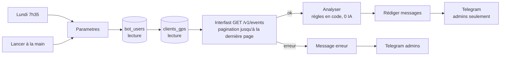

# Proposition : clients posés sans entretien

**Statut : proposition + brouillon non publié** (`proposals/clients-sans-entretien.workflow.json`). Rien n'a été créé ni modifié sur n8n ou Interfast.

## En bref

- **Ce besoin est déjà couvert en partie.** Le workflow actif *Climapro - Clients sans entretien* (V1) remplit chaque nuit la table `clients_sans_entretien`. L'outil du bot et le tableau de bord technicien la lisent. Je ne propose donc pas un deuxième système parallèle : je propose une **V2 de l'analyse**, testée sur les vraies données, plus un rapport Telegram admin.
- **La V1 mélange deux questions.** « Jamais entretenu depuis la pose » et « pas d'entretien depuis 6 mois » ne sont pas la même chose. Elle raisonne aussi par client et non par adresse, et elle tranche seule des cas qu'elle devrait signaler.
- **Résultat V2 sur les données du 20/10/2026** : 44 clients à proposer, 37 à vérifier, et 19 « sur la route » d'une intervention prévue dans les 10 jours.
- **Zéro IA.** Un modèle ne résout pas les doutes rencontrés. Ils viennent de données Interfast incomplètes (chantier jamais clôturé, entretien collé à une pose), et une vérification d'une minute par Laurent vaut mieux qu'une supposition.

## 1. Comment les workflows lisent Interfast aujourd'hui (mécanisme réutilisé tel quel)

| Élément | Valeur |
|---|---|
| Credential | `Interfast API` (Header Auth, id `GgJ5wsyGIUSWY0cN`), utilisé par 14 workflows |
| Interventions | `GET https://app.inter-fast.fr/v1/events` avec `start`, `end`, `page`, `count=100`, `archived=false`, `meeting=false`, `orderBy=start` (exactement les paramètres de la V1) |
| Devis | `GET /v1/billing/quotations` (`toPlan=true` pour les signés à planifier, `clients=` pour un client) |
| Clients | `GET /v1/crm/search` (pagination `page`/`size`) ; fiche : `GET /v1/client/{id}` |
| Sous-workflow *Interfast - Lecture* | Lit seulement la page 0 de chaque liste. Il convient pour le bot, pas pour un parcours complet de l'historique. La V2 appelle donc l'API en direct, comme la V1, *Cache clients GPS* et *Devis signés à planifier*. |

**Format d'une intervention** (champs vus dans la dernière exécution de la V1) : `id`, `start`, `end`, `type`, `title`, `category` (`intervention` / `absence` / `task`), `lifecycleState` (`completed` / `created` / `in_progress` / `cancelled`), `finished`, `client {id, name, type}`, `address`, `lat`, `lon`, `maintenance` (`{id, visit}` pour une visite de contrat, sinon vide), `users [{id, firstName, lastName}]`, `secondReference` (n° de devis), `worksite`, `reference`.

**Ce que contient Interfast** (dernière exécution de la V1, comptages seulement) :

| | |
|---|---|
| Interventions et absences | 1 956 (du 04/09/2023 au 23/02/2027), soit 20 pages de 100 |
| Absences (congés, formation) | 184, à ignorer |
| Visites de contrat (`maintenance` renseigné) | 234 |
| Avec coordonnées GPS | 1 748 sur 1 956 |

Types d'intervention, par fréquence :

| Type Interfast | Nombre | Classement V2 |
|---|---|---|
| Entretien - Maintenance de PAC et climatisation | 638 | entretien |
| Dépannage | 434 | dépannage |
| Avancement de chantier | 215 | chantier (pose en cours) |
| Fin d'installation - PAC Air/Air | 137 | **pose** |
| Visite avant devis (+ variantes Climatisation particulier, PAC Air/Eau) | 175 | devis |
| Congés payés, Formation, RTT, Absence injustifiée | 161 | ignoré |
| Intervention | 96 | selon le titre |
| Intervention - ClimatPro | 35 | selon le titre |
| Autre | 23 | selon le titre |
| Devis | 19 | devis |
| Fin d'installation - PAC Air/Eau | 9 | **pose** |
| Compte rendu / PV de réception de chantier | 7 | chantier |
| Cerfa 15497 | 4 | selon le titre |

**Il n'existe pas d'objet « contrat d'entretien » dans l'API publique Interfast** (recherche faite dans sa documentation). Le seul signal de contrat est le champ `maintenance` des interventions, comme dans la V1.

## 2. Limites de la V1 constatées

1. **Mauvaise question.** La V1 liste aussi des clients entretenus après la pose, si le dernier entretien a plus de 6 mois. Ce sont des relances, pas des « jamais entretenus ».
2. **Par client, pas par adresse.** Un client avec deux villas, posée à Mougins et entretenue à Cannes, disparaît de la liste. La V2 en retrouve un dès aujourd'hui.
3. **Elle tranche au lieu de signaler.** Elle compte une « repose » comme une pose, et un entretien fait le jour de la pose comme l'entretien de la clim posée. Une dépose pour stockage juste après la pose ne déclenche rien.
4. **Elle se trompe en silence.** Ses appels Interfast sont en `continueRegularOutput` : une page en erreur donne une liste fausse sans alerte. Le nombre de pages est figé à 40, et la V1 en lit 20 pleines aujourd'hui. Au-delà de 4 000 interventions, les plus récentes seront perdues sans prévenir, entretiens compris, ce qui fera apparaître de faux « sans entretien ».
5. **Elle travaille pour rien.** Elle fait 40 appels chaque nuit, dont 20 qui reviennent vides, soit environ 14 600 appels par an.

## 3. Architecture proposée



- **Une seule lecture Interfast**, avec la pagination native du node HTTP. Elle s'arrête d'elle-même à la première page incomplète, soit 20 appels aujourd'hui, une fois par semaine. La même lecture couvre le planning à venir, utilisé pour le bonus « sur la route ».
- **Garde-fous** : si Interfast répond en erreur, ou si la dernière page lue est pleine, les admins reçoivent « rapport non envoyé » au lieu d'une liste fausse.
- **Aucune écriture.** Le brouillon ne touche ni Interfast ni aucune Data Table. Brancher la V2 sur la table `clients_sans_entretien` est une seconde étape, décrite en section 8.

## 4. Données lues

| Source | Pourquoi | Mode |
|---|---|---|
| Interfast `/v1/events`, depuis le 01/01/2018 jusqu'à +13 mois | Historique des poses et entretiens, contrats, planning à venir | GET |
| Data Table `bot_users` | Destinataires : `actif = true` et `role = admin` | Lecture |
| Data Table `clients_gps` | Coordonnées de secours quand une intervention n'a pas de GPS (géocodage IGN fait chaque nuit par *Cache clients GPS*) | Lecture |

## 5. Règles de détection

**Classement d'une intervention.** Le type Interfast fait foi. Le titre ne sert que pour les types génériques (Intervention, Intervention - ClimatPro, Autre, Cerfa) :

- **Pose** : type « Fin d'installation - … ». Pour un type générique, un titre « pose / installation / mise en service / remplacement de l'unité ».
- **Entretien** : type « Entretien - Maintenance… », ou toute visite de contrat (`maintenance` renseigné).
- **Dépannage** : type « Dépannage », ou titre « panne / fuite / erreur / SAV / recharge… ». Un dépannage **ne compte pas** comme entretien ; il est affiché en information.
- **Chantier** : « Avancement de chantier », CR ou PV de chantier. C'est une pose en cours, pas une pose terminée.
- **Ignorés** : absences, tâches, interventions annulées, visites avant devis. « Suite devis DC1234 » dans un titre n'en fait pas une visite devis.

**Par site, pas par client.** Deux interventions sont sur le même site si l'adresse normalisée est identique ou si elles sont à moins de 150 m.

**Règle principale.** On prend la **première pose qui n'a été suivie d'aucun entretien net**. Si elle date d'au moins 12 mois, le client est listé : « jamais entretenu depuis le JJ/MM/AAAA ». Un entretien net est clôturé, a un libellé sans ambiguïté et n'est pas collé à une pose.

**Exclusions nettes** (comptées dans l'en-tête du rapport) :
- **Sous contrat** : une visite de contrat dans les 18 derniers mois ou à venir. Ces clients sont suivis ailleurs.
- **Entretien déjà planifié** dans le futur.
- **Déjà entretenu** après toutes ses poses.
- **Pose de moins de 12 mois.**
- **Client « TOSHIBA »** : règle reprise de la V1 (interventions pour le fabricant).

**Cas ambigus : signalés, jamais devinés.** Ils vont dans la section « À vérifier » avec la raison. Effectifs sur les données du jour :

| Raison | Nombre |
|---|---|
| Chantier sans « Fin d'installation » dans Interfast (chantier de plus de 12 mois) | 16 |
| Pose passée jamais clôturée dans Interfast | 13 |
| Entretien collé à une pose (moins de 30 jours) : sur la clim posée ou sur une autre ? | 3 |
| Entretien au libellé ambigu (ex. « Remise en service ») | 2 |
| « Repose » : réinstallation par ClimatPro, à compter comme une pose ? | 2 |
| Dépose après la pose : la clim est-elle encore en place ? | 2 |
| Pose déduite d'un libellé indirect | 2 |
| Libellé mélangeant pose + entretien, ou pose + dépannage | 2 |
| Ancien contrat (dernière visite il y a plus de 18 mois) : résilié ? | 1 |

Le rapport liste aussi les **libellés non reconnus** (aujourd'hui : des types « Intervention », « Intervention - ClimatPro » et « Cerfa 15497 » sans mot-clé dans le titre). Les règles s'ajustent dessus.

**Bonus « sur la route ».** Pour chaque client listé ou à vérifier, le rapport cherche l'intervention prévue la plus proche dans les 10 prochains jours, dans un rayon de 1 km, chez un autre client. Il donne le jour, le technicien et la distance. Les techniciens sont nommés à partir du prénom fourni par Interfast. Sur les données du jour :

| Rayon | Clients sur 10 jours | Dont sûrs | Interventions prévues concernées |
|---|---|---|---|
| 0,5 km | 9 | 6 | 5 |
| **1 km (retenu)** | **19** | **13** | **10** |
| 2 km | 47 | 27 | 11 |
| 3 km | 61 | 37 | 13 |

À 3 km, la liste devient inutile : la Côte d'Azur est trop dense.

## 6. Format de sortie

Le rapport part chaque **lundi à 7h35**, ou à la demande, aux admins de `bot_users`, en privé via le bot Telegram du *Bot - Assistant*. Il fait environ 4 messages de 3 900 caractères au plus. Exemple avec des noms fictifs :

```
🔧 Clients posés sans entretien (pose ≥ 12 mois, hors contrat)
44 à proposer, 37 à vérifier.
Écartés : 11 sous contrat, 1 entretien déjà planifié, 10 déjà entretenus, 47 posés depuis moins de 12 mois.
Base : 1764 interventions Interfast (20 pages), historique depuis l'arrivée d'Interfast seulement.

🚐 Sur la route (≤ 1 km d'une intervention prévue dans les 10 jours)
ven. 23/10 — Christophe chez DURAND (Cannes)
   → MARTIN à 0,4 km, 19 mois sans entretien · id 400001
   → SCI LES PINS à 0,9 km, 14 mois sans entretien [à vérifier] · id 400002

📍 Mougins (6)
• DUPONT — posé le 03/03/2025 (19 mois) : Fin d'installation - PAC Air/Air : multi-split 3 unités · 1 dépannage(s) depuis · id 400003

❓ À vérifier avant de proposer (37)
• LEROY (Vallauris) — repose du 12/03/2025 : réinstallation par ClimatPro, à compter comme une pose ? (« Intervention : Repose unité ») · id 400004

🏷️ Libellés non reconnus (ni pose, ni entretien, ni dépannage), pour régler les règles :
• « intervention : … » × n
```

L'`id` est l'identifiant client Interfast : « fiche client 400003 » au bot donne téléphone et historique.

## 7. Coût

| Poste | V1 actuelle | V2 proposée |
|---|---|---|
| Appels Interfast | 40 par nuit, environ 14 600 par an | 20 par semaine aujourd'hui, environ 1 000 par an ; augmente d'une page par tranche de 100 interventions |
| Appels IA | 0 | **0** |

**Si l'on voulait Haiku pour classer les libellés génériques** : environ 30 libellés par semaine, à environ 400 jetons en entrée et 50 en sortie. Avec Claude Haiku 5.5 ($0,10 / $0,50 par million de jetons), cela fait environ $0,002 par rapport, soit 10 centimes par an. **Je ne le recommande pas.** Ce n'est pas une question de coût : les doutes rencontrés sont des faits manquants dans Interfast, et un modèle ne ferait que deviner. Les règles en code sont relisibles et testables, et elles donnent toujours le même résultat.

## 8. Mise en route proposée

1. **Importer** `proposals/clients-sans-entretien.workflow.json` dans n8n. Il arrive inactif. Vérifier que les credentials *Interfast API* et *Telegram account* sont bien reliés.
2. **Lancer à la main** (« Lancer à la main ») et relire le rapport reçu sur Telegram. Comparer avec la liste du tableau de bord (V1).
3. **Traiter la section « À vérifier ».** Corriger dans Interfast ce qui doit l'être : clôturer les poses, ajouter les « Fin d'installation » manquantes. Ces corrections améliorent aussi le bot, le brief 18h et le tableau de bord.
4. **Ensuite seulement**, deux options, à décider par Laurent :
   - **A.** Activer la V2 telle quelle (rapport du lundi) et laisser la V1 pour le bot et le tableau de bord.
   - **B.** Faire écrire la V2 dans `clients_sans_entretien`, à la place de l'analyse V1, puis désactiver la V1. Le bot et le tableau de bord profitent alors des nouvelles règles. Il faudra ajouter les colonnes `a_verifier` et `raisons` à la table et adapter *Outil - Clients sans entretien*. C'est une modification de production, donc à faire avec Laurent.

## 9. Ce qui n'a pas pu être vérifié

- **Le brouillon n'a jamais tourné dans n8n.** La règle de lecture seule interdit de le créer sur le serveur. Le code des 4 nodes Code a été exécuté hors n8n, avec Node.js et Luxon : sur 15 cas fictifs construits pour couvrir chaque règle, puis sur les 1 956 interventions réelles de la dernière exécution V1. Ce qui n'a pas été exécuté : la pagination native du node HTTP (paramétrage vérifié contre la définition officielle du node), les lectures de Data Tables et l'envoi Telegram (copiés des workflows existants).
- **L'historique ne commence qu'en septembre 2023**, à l'arrivée d'Interfast. Les poses plus anciennes sont dans le Sheet *Index-Factures-ClimatPro*, alimenté par les workflows « Archives factures ». Elles pourraient être ajoutées comme seconde source. Je ne l'ai pas fait : le format de ce Sheet n'a pas été vérifié.
- **La règle « contrat = visite de contrat dans les 18 derniers mois »** reprend la V1. Un contrat signé mais sans visite encore planifiée n'est pas vu. L'API publique Interfast n'expose pas les contrats eux-mêmes.
- **Le client « TOSHIBA » exclu** : règle reprise de la V1 sans en connaître la raison exacte.
- **Les distances « sur la route » sont à vol d'oiseau**, pas des temps de trajet.
